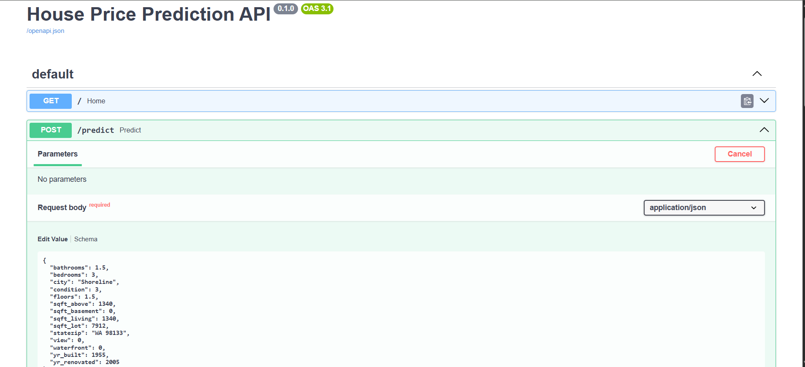
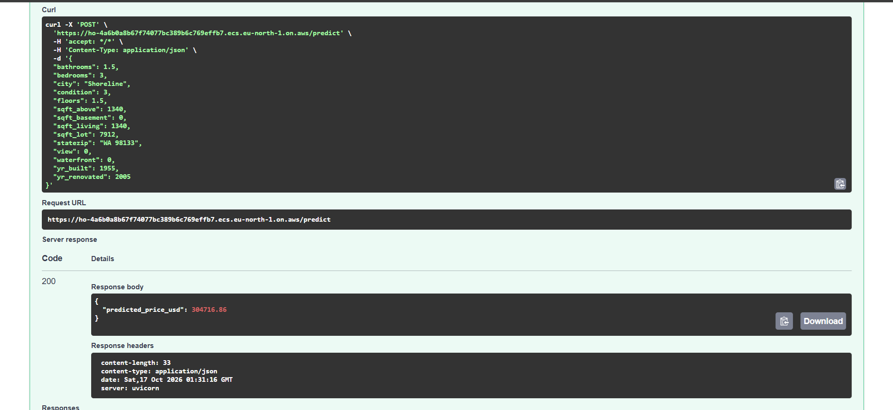
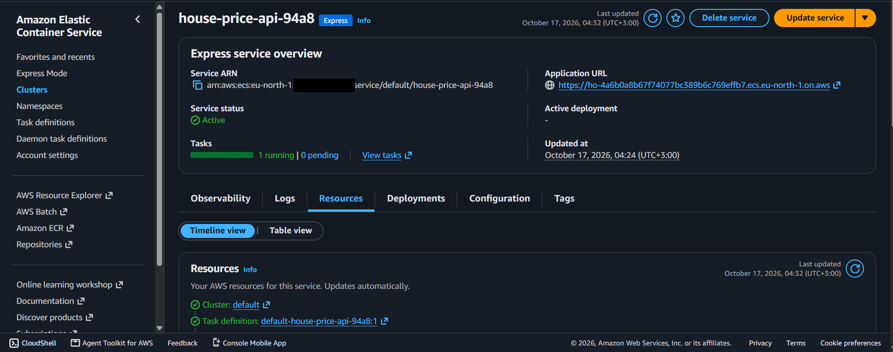

# House Price Prediction

A regression project that predicts the sale price of houses in the Seattle area (Washington State, USA). It is a learning project that covers the full modelling workflow: cleaning, encoding, scaling, model comparison with cross-validation, hyperparameter tuning, final evaluation and saving the trained model. A small API serves the model, it is packaged with Docker, and it was tested on AWS.

## Problem

Given the features of a house (size, rooms, condition, year built, location...), predict its sale price in US dollars.

## Dataset

- **Source:** Kaggle, "House price prediction" dataset by shree1992 — https://www.kaggle.com/datasets/shree1992/housedata
- 4,600 houses, 18 columns. All houses are in Washington State, mostly the Seattle area (Seattle, Renton, Bellevue, Redmond, Kirkland...), sold between May and July 2014.
- Target: `price` (USD).
- The data file `data.csv` is included in this repository for convenience. All rights belong to the original dataset owner; please refer to the Kaggle page above for details.

## Repository Files

| File | Description |
|---|---|
| `House_Price_Prediction.ipynb` | The full workflow: cleaning, encoding, scaling, model comparison, tuning, evaluation and saving the model |
| `app.py` | FastAPI application that loads the saved model and returns a price estimate |
| `requirements.txt` | Python libraries (with exact versions) needed to run the API |
| `Dockerfile` | Builds the Docker image that runs the API |
| `images/` | Screenshots of the AWS test deployment |
| `data.csv` | The dataset |
| `ct.joblib` | Saved encoder (`ColumnTransformer` with one-hot encoding) |
| `scaler.joblib` | Saved `StandardScaler` |
| `svr_model.joblib` | Saved final model (tuned SVR) |

## Approach

1. Removed rows with an invalid price (`price = 0`): 49 rows, leaving 4,551.
2. Dropped columns that do not help the model: `date`, `street`, `country`.
3. One-hot encoded `city` and `statezip`.
4. Split the data 75% train / 25% test.
5. Scaled the features with `StandardScaler` (fitted on the training set only).
6. Trained on the log of the price (`log1p`) and converted predictions back to dollars (`expm1`).
7. Compared four models with 5-fold cross-validation on the training set.
8. Tuned the best model (SVR) with `GridSearchCV`.
9. Evaluated the final model once on the test set.
10. Saved the encoder, the scaler and the model with `joblib`.

## Key Decisions

**Removing `price = 0`.** A house cannot sell for zero dollars, so these rows are invalid data.

**Dropping `date`, `street` and `country`.** `date` covers only about two months, `street` is almost unique for every house (it identifies a house, it does not describe it), and `country` has a single value.

**Log transform of the price.** The price is strongly skewed (skewness about 25) because of a few very expensive houses. After the log transform the skewness drops to about 0.33. This lowered the test RMSE from about 199,000 to about 175,000 dollars with the same linear model.

**Scaling.** `StandardScaler` is fitted on the training set only, so no information from the test set leaks into training. Scaling is needed for SVR. It is applied to all columns, including the one-hot columns, which is not strictly necessary.

**Metrics.** R² and RMSE, both measured in dollars on the original price, so that models are compared on the same scale.

**Model selection.** Cross-validation is computed on the training set only, so the test set is used just once, at the end.

## Results

Test set (1,138 houses):

| Model | R² | RMSE (USD) |
|---|---|---|
| Linear Regression, raw price (baseline) | 0.706 | 198,731 |
| Linear Regression, log price | 0.771 | 175,475 |
| SVR, default settings | 0.768 | 176,544 |
| **SVR tuned (C=10, epsilon=0.1)** | **0.793** | **166,598** |

5-fold cross-validation on the training set (R² on the log price):

| Model | R² (mean ± std) |
|---|---|
| Linear Regression | 0.7697 ± 0.0287 |
| SVR (default) | 0.7680 ± 0.0325 |
| Random Forest | 0.7147 ± 0.0320 |
| XGBoost | 0.7437 ± 0.0353 |
| SVR tuned (C=10, epsilon=0.1) | 0.7776 |

Linear Regression and default SVR are practically tied (the difference is much smaller than the standard deviation). Tuning SVR gave a small but consistent improvement. Random Forest and XGBoost were used with default settings and did not outperform the simpler models; they were not tuned, so this does not prove they are worse in general.

## Limitations

- The error is still large: an RMSE of about 167,000 dollars against a median price of about 465,000.
- The data is from 2014 and from one region, so the model should not be used to estimate current prices or prices in other places.
- The test set has only 1,138 houses, including 3 houses above 3 million dollars, which have a large effect on RMSE.
- The one-hot encoder was fitted on the whole dataset before the train/test split. The effect here is small, but fitting it on the training set only (for example in a `Pipeline`) is the correct practice.
- `city` and `statezip` describe the same thing (location) and are both used.
- `sqft_living` equals `sqft_above + sqft_basement` for every house, so one of these columns is redundant.
- `yr_renovated = 0` (not renovated) is treated as a number, and it is not transformed.
- Outliers (the highest price is 26.6 million dollars) were not removed.
- Random Forest and XGBoost were not tuned.
- The saved model only accepts cities and zip codes that exist in the training data (44 cities and 77 zip codes).
- The API was deployed on AWS only as a short test; it has no authentication, no monitoring and no live demo.

## How to Run

1. Clone this repository.
2. Install the requirements: `pip install -r requirements.txt` (enough for the API). To run the notebook you also need `pip install xgboost jupyter`.
3. Open `House_Price_Prediction.ipynb` and run all cells. The notebook reads `data.csv` from the same folder.

The saved `.joblib` files depend on the scikit-learn version used to create them (the version in `requirements.txt`), so use the same version when loading them.

## API

A small FastAPI application (`app.py`) loads the saved encoder, scaler and model and returns a price estimate for a house.

Start the server from the project folder:

```
uvicorn app:app --reload
```

Then open http://127.0.0.1:8000/docs, choose `POST /predict`, click **Try it out** and **Execute**.

Example request body:

```json
{
  "bedrooms": 3,
  "bathrooms": 1.5,
  "sqft_living": 1340,
  "sqft_lot": 7912,
  "floors": 1.5,
  "waterfront": 0,
  "view": 0,
  "condition": 3,
  "sqft_above": 1340,
  "sqft_basement": 0,
  "yr_built": 1955,
  "yr_renovated": 2005,
  "city": "Shoreline",
  "statezip": "WA 98133"
}
```

Example response:

```json
{
  "predicted_price_usd": 304716.86
}
```

If the `city` or `statezip` was not in the training data, the API returns a `422` error such as `Unknown city: Atlantis`.

## Run with Docker

The API is packaged in a Docker image, so it runs the same way on any machine with Docker installed.

```
docker build -t house-price-api .
docker run -p 8000:8000 house-price-api
```

Then open http://127.0.0.1:8000/docs and use `POST /predict` as described above.

The image is based on `python:3.13-slim` and installs the exact versions from `requirements.txt`. It contains only what the API needs (`app.py` and the three `.joblib` files). The notebook and the dataset are not copied into it.

## Deployment on AWS

The Docker image was deployed on AWS as a test and then taken down, so there is no live demo link.

- The image was pushed to **Amazon ECR** (private repository).
- The service was created with **Amazon ECS Express Mode** in `eu-north-1` (Stockholm). It runs the container on AWS Fargate (1 vCPU, 2 GB, one task) behind an Application Load Balancer with HTTPS.
- The container port is 8000 and the health check path is `/`.
- `POST /predict` returned status 200 with `predicted_price_usd: 304716.86` for the example request above, the same value as locally and in Docker.
- All AWS resources were deleted after the test to avoid cost.







Everything was created manually from the AWS console. There is no infrastructure as code, no CI/CD, no authentication and no monitoring yet.

## Technologies

Python, Pandas, NumPy, Scikit-learn, XGBoost, Joblib, FastAPI, Uvicorn, Docker, AWS (ECR, ECS Fargate), Jupyter Notebook

## Next Steps (planned, not implemented yet)

- CI/CD with GitHub Actions.
- Monitoring.
